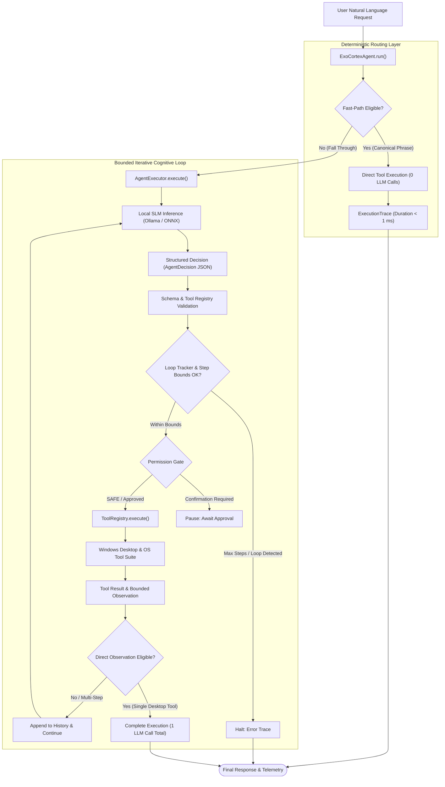

# ExoCortex 🧠⚡

**Hardware-Agnostic, Local-First AI Agent for Windows**

[](https://microsoft.com/windows)
[](https://www.python.org/)
[]()

ExoCortex is a hardware-agnostic, local-first AI agent for Windows that interprets natural-language requests, reasons through tasks, and executes them using permission-controlled desktop tools.

Unlike cloud-dependent conversational bots or unconstrained scripting assistants, ExoCortex runs entirely on-device, enforces a strict three-tier security permission model, and interacts with the operating system exclusively through typed, schema-validated tools.

---

## Key Highlights

- **100% On-Device & Private**: Zero cloud AI APIs, zero external telemetry, zero prompt or desktop data leakage. All reasoning and tool executions execute locally.
- **Hardware-Agnostic Execution**: Seamlessly operates on standard x86_64 CPUs, ARM64 devices, or Windows systems with DirectML hardware acceleration.
- **Dual Inference Engine Support**:
  - **Local Server Runtime**: Compatible with local OpenAI-compatible endpoints such as Ollama running **Qwen3:4B** or similar Small Language Models (SLMs).
  - **Embedded ONNX Runtime**: Embedded neural execution with KV-caching, auto-selecting DirectML acceleration or CPU execution.
- **Read-Only Desktop & OS Awareness**: Native Win32 window enumeration, UI Automation element tree inspection via Windows Accessibility APIs, and running process telemetry.
- **Two-Tier Execution Optimization**:
  - **Deterministic Fast Path**: Sub-millisecond dispatch for unambiguous canonical queries (e.g., listing windows, inspecting processes, querying system diagnostics), bypassing model inference entirely (0 LLM calls).
  - **Direct Observation Completion**: Automatically completes single-tool desktop inspections upon successful observation, eliminating redundant synthesis calls.
- **Strict Permission & Sandbox Boundaries**: Read-only tools execute safely; state-modifying actions require explicit authorization; filesystem operations are sandboxed to `~/.exocortex/workspace`.
- **Bounded Autonomous Reasoning**: Multi-step iterative cognitive loop featuring loop detection, maximum step limits, and comprehensive JSON telemetry traces.

---

## Architecture

ExoCortex is organized into four decoupled layers: Interface, Execution Engine, Reasoning Brain, and Tool Registry.



---

## Tool Registry & Security Safeguards

ExoCortex never executes arbitrary shell commands or unvalidated scripts. Every capability is exposed as a typed `BaseTool` registered in `ToolRegistry` and executed with strict bounds.

### Security Architecture & Permission Framework
The execution engine supports a three-tier permission model:
- **`SAFE`**: Automatically executed without prompting. Currently, **all 13 registered built-in tools are declared as `SAFE`**, backed by strict programmatic safeguards:
  - **Allowlisted Application Execution**: `launch_application` only launches known, non-destructive tools (`notepad`, `calc`, `mspaint`, `explorer`). Arbitrary paths or binaries are strictly blocked.
  - **Scheme-Validated URL Launching**: `open_url` strictly requires `http://` or `https://`. File schemes (`file://`), script injection (`javascript:`), and payload URIs (`data:`) are rejected.
  - **Sandboxed Workspace Filesystem**: `list_directory`, `read_text_file`, and `create_directory` are strictly confined inside `~/.exocortex/workspace`. Path traversal (`..`) outside the workspace root is rejected with a security violation.
  - **Read-Only Inspection**: Windows desktop windows (`list_open_windows`), UI elements (`inspect_window_ui_elements`), and running processes (`list_processes`) are non-mutating and strictly read-only.
- **`CONFIRMATION_REQUIRED`**: Architectural framework support for state-modifying actions requiring explicit user callback approval before execution.
- **`RESTRICTED`**: High-risk actions (arbitrary shell commands, registry modifications, destructive deletion) blocked by default.

| Permission Level | Enforcement Policy | Current Tool Implementation |
|---|---|---|
| **`SAFE`** | Read-only or allowlisted/sandboxed execution without user prompt. | All 13 tools: `list_open_windows`, `inspect_window_ui_elements`, `list_processes`, `system_info`, `health_check`, `echo`, `list_directory`, `read_text_file`, `create_directory`, `launch_application`, `open_url`, `web_search`, `fetch_web_page` |
| **`CONFIRMATION_REQUIRED`** | Pauses execution and awaits user callback confirmation. | Supported by `ToolRegistry` & `AgentExecutor` pipeline for future modifying extensions. |
| **`RESTRICTED`** | Arbitrary execution or high-risk mutation. | Strictly prohibited. |

### Built-in Tool Suite

1. **Desktop Awareness**:
   - `list_open_windows`: Enumerates visible top-level application windows using Win32 `EnumWindows` and `DwmGetWindowAttribute` APIs, safely filtering cloaked and hidden background processes.
   - `inspect_window_ui_elements`: Inspects the interactive UI Automation element tree of a target window via Windows Accessibility APIs, bounded by depth and element count limits.
   - `list_processes`: Inspects running system processes with PID, executable name, and memory telemetry.
2. **Workspace Filesystem**:
   - `list_directory`: Lists directory contents strictly confined inside `~/.exocortex/workspace`. Directory traversal (`..`) is strictly blocked.
   - `read_text_file`: Reads text files inside the workspace sandbox (up to 1 MB).
   - `create_directory`: Creates subdirectories inside the workspace sandbox.
3. **Application & Web Operations**:
   - `launch_application`: Launches allowlisted desktop utilities (e.g., `notepad`, `calc`, `mspaint`, `explorer`). Arbitrary executable paths are rejected.
   - `open_url`: Opens validated `http://` and `https://` URLs in the default browser. Dangerous schemes (`file://`, `javascript:`, `data:`) are rejected.
   - `web_search`: Queries DuckDuckGo HTML search for public research queries without browser automation overhead.
   - `fetch_web_page`: Fetches and extracts readable text from public web pages.
4. **System Diagnostics**:
   - `system_info`: Inspects host OS, processor architecture, physical memory, and available acceleration providers.
   - `health_check`: Probes Python compatibility, SLM provider connectivity, and tool registry integrity.
   - `echo`: Parameter passing verification tool.

---

## Execution Optimizations

To deliver responsive user experiences on local hardware, ExoCortex integrates two complementary execution optimizations:

### 1. Deterministic Fast Path (`FastPathRouter`)
High-frequency canonical requests bypass model deliberation entirely:
- **Scope**: Canonical zero-argument queries for window enumeration, process listing, system diagnostics, and health checks.
- **Matching**: Exact normalized dictionary matching (case-folded, whitespace-collapsed, punctuation-stripped). No fuzzy matching, parameter extraction, or mutation bypass.
- **Latency**: Sub-millisecond dispatch (<1 ms) with **0 LLM calls**.

### 2. Direct Observation Completion
When a user prompt resolves to a single read-only desktop observation (such as `list_open_windows`, `list_processes`, or `inspect_window_ui_elements`), the observation output is returned directly to the user:
- **Policy**: Applies only when `planned_steps == 1`, tool is in the safe direct-completion allowlist, and execution succeeded.
- **Latency Impact**: Saves a full second inference synthesis turn (~90–140s on CPU), cutting task completion time in half.

---

## Project Structure

```
exocortex/
├── agent.py                 # ExoCortexAgent orchestrator & entry point
├── config.py                # Environment configuration & runtime settings
├── benchmarking.py          # Local SLM inference benchmark suite
├── cli.py                   # Command-line interface
├── hardware.py              # Host system hardware & memory detection
├── health.py                # Component health diagnostic probes
├── schema.py                # Pydantic schemas (AgentDecision, StructuredStep)
├── execution/
│   ├── executor.py          # Multi-step cognitive loop engine (AgentExecutor)
│   ├── fast_path.py         # Sub-millisecond deterministic FastPathRouter
│   ├── state.py             # ExecutionState & loop detection tracker
│   └── trace.py             # Structured ExecutionTrace telemetry recorder
├── runtime/
│   ├── capabilities.py      # Execution provider capability models & RuntimeProfile
│   ├── detector.py          # ONNX Runtime provider & memory discovery
│   └── provider.py          # RuntimeDispatcher for auto/dml/cpu resolution
├── slm/
│   ├── base.py              # Abstract SLMProvider interface
│   ├── factory.py           # Provider resolver (local_server, onnx, mock)
│   ├── local_provider.py    # OpenAI-compatible HTTP provider (Ollama / Qwen3:4B)
│   ├── local_model_engine.py# Real ONNX neural engine wrapper
│   ├── onnx_engine.py       # Autoregressive transformer engine with KV-cache
│   ├── parser.py            # JSON schema validation & repair engine
│   └── prompts.py           # System prompts, tool schemas & few-shot examples
└── tools/
    ├── base.py              # BaseTool, ToolResult, PermissionLevel
    ├── builtin.py           # SystemInfoTool, HealthCheckTool, EchoTool
    ├── registry.py          # Central ToolRegistry & dispatch validation
    ├── web/                 # DuckDuckGo search & web page fetch tools
    └── windows/             # Win32 desktop windows, UI Automation, filesystem
```

---

## Installation & Setup

### Prerequisites
- **Operating System**: Windows 10 or Windows 11 (x86_64 or ARM64)
- **Python**: Version 3.11, 3.12, or 3.13
- **Local Model (Recommended)**: [Ollama](https://ollama.com/) with `qwen3:4b`

### 1. Clone & Install Dependencies
```powershell
git clone https://github.com/aadesh-2006/ExoCortex.git
cd ExoCortex

# Create and activate a virtual environment
py -m venv .venv
.\.venv\Scripts\Activate.ps1

# Install runtime dependencies
pip install -r requirements.txt

# Install development & test dependencies
pip install -r requirements-dev.txt
```

### 2. Configure Environment
Copy `.env.example` to `.env` or set environment variables:
```powershell
Copy-Item .env.example .env
```

Key environment configuration variables:
```ini
# SLM Provider: local_server (Ollama), onnx, or mock
EXOCORTEX_SLM_PROVIDER=local_server
EXOCORTEX_MODEL_NAME=qwen3:4b
EXOCORTEX_LOCAL_SERVER_URL=http://localhost:11434/v1
EXOCORTEX_LOCAL_SERVER_TIMEOUT=180.0

# Hardware Acceleration: auto, dml, or cpu
EXOCORTEX_HARDWARE_TARGET=auto

# Security & Optimization
EXOCORTEX_REQUIRE_CONFIRMATION_FOR_SENSITIVE=true
EXOCORTEX_ENABLE_FAST_PATH=true
EXOCORTEX_DIRECT_OBSERVATION_COMPLETION=true
```

---

## Usage & CLI Reference

> [!TIP]
> On Windows, invoke commands using the Python launcher `py -m ...`. If you have activated your virtual environment (`.\.venv\Scripts\Activate.ps1`), `python -m ...` may also be used.

### System Status & Health Probes
```powershell
# Inspect overall system health, SLM connectivity, and registered tools
py -m exocortex.cli status

# Inspect hardware architecture, available execution providers, and memory
py -m exocortex.cli hardware

# List all registered tools and their security permission levels
py -m exocortex.cli tools
```

### Running Interactive Desktop Tasks
```powershell
# Fast-path canonical request (executes in <1 ms with 0 LLM calls)
py -m exocortex.cli run --prompt "list open windows"

# Parameterized desktop inspection
py -m exocortex.cli run --prompt "Check which windows are open and inspect their UI elements"

# Inspect files in the sandboxed workspace
py -m exocortex.cli run --prompt "List the files in my workspace"

# Run with full structured execution trace
py -m exocortex.cli run --prompt "What processes are currently running?" --trace
```

### Local Inference Benchmarking
```powershell
# Run the built-in local inference benchmark suite
py -m exocortex.cli benchmark
```

---

## Running the Test Suite

ExoCortex maintains comprehensive automated test coverage spanning unit tests, execution traces, permission gating, and tool dispatch:

```powershell
# Run the full test suite
py -m pytest -v

# Run focused fast-path and execution tests
py -m pytest tests/test_fast_path.py tests/test_direct_completion.py -v

# Run with coverage report
py -m pytest --cov=exocortex tests/
```
